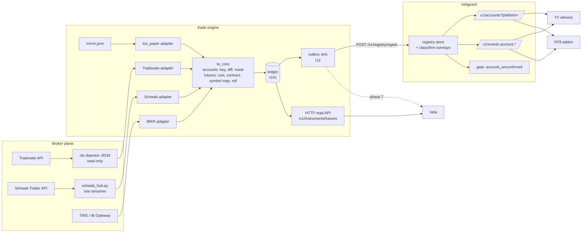

# Broker platform: trade-engine as the single broker port

| | |
|---|---|
| Status | In review |
| Owner | owner (approver) |
| Author | Opus design thread |
| Last updated | 2026-11-11 |
| Repos touched | trade-engine (core), nt8-riskguard (consumer), nt_tradovate_mcp / ntx (source), Vela (consumer) |
| Plan | [../BROKER_PLATFORM_PLAN.md](../BROKER_PLATFORM_PLAN.md) |
| Briefs | [../briefs/BP-COMMON.md](../briefs/BP-COMMON.md), [BP-1-FUTURES](../briefs/BP-1-FUTURES.md), [BP-2-ACCOUNTS](../briefs/BP-2-ACCOUNTS.md); riskguard `docs/product/slice_briefs/ACCT-REGISTRY-1.md` |
| Issues | L-246 (account registry), PNL-SOURCE-1 |

## 1. Summary

Every component that touches a broker today keeps its own account list and its own
symbol spelling. riskguard has a flat fleet of 111 accounts that any surface can add
to. Vela has its own tables. NT8, TV, Tradovate and Schwab each spell the same contract
differently.

This design makes trade-engine the single broker port:

- one adapter per broker is the authority on that broker's accounts, positions, fills
  and realized P&L;
- one canonical futures instrument and symbol map lives in `te_core`;
- riskguard and Vela consume both and never keep a copy.

Tradovate, read through the ntx daemon, is the first broker. Schwab and IBKR plug into
the same contract. Platforms (TV, NT8, Tradovate web, thinkorswim, TWS) become routes to
a broker account, not sources of truth.

## 2. Context and problem

- **No authority on which accounts exist.** riskguard's `/v1/fleet` is about 560 KB for
  111 accounts (86 sim). 90 rows have no surface, and only about 20 are ever routed
  through TV or Tradovate. The "venue" field holds the prop firm, not the route.
- **One venue's slowness blocks another.** The TV witness reads the whole fleet with an
  800 ms timeout. On a miss it set its known-accounts list to empty, which blocked TV
  trading for about 10 s. That happened whenever NT8 load or a journal flush slowed the
  service (L-246; riskguard `surfaces/tv-daemon/witness/witness.mjs:750-770`,
  `surfaces/common/state/client.mjs:93`).
- **No futures instrument in the engine.** `domain/instruments.py` has `Equity` (:97),
  `OptionContract` (:115) and `Combo` (:196) only. Tick values are duplicated across
  riskguard rules and Vela.
- **No Tradovate adapter in the engine.** `BrokerAdapter`
  (`interfaces/broker.py:201`) has only Sim and `tos_paper` implementations. ntx
  already holds the Tradovate connection, but it pushes straight to riskguard
  (`ntx/src/observer.rs`, `RG_SERVICE_URL`), bypassing the engine.
- **The adapter has no account list.** `BrokerAdapter` knows its own `VenueIdentity`
  (`broker.py:33`), but it cannot list a broker's accounts or report when the list
  changes.
- **Owner request (2026-11-11):** design for adding another broker or API tomorrow,
  with the same model for Vela. Accelerate using existing infrastructure where it
  exists.

## 3. Goals and non-goals

**Goals**

1. A new broker is added by writing one adapter. No riskguard, Vela or surface change is
   needed beyond configuration.
2. Each broker account has exactly one record, keyed `broker:accountId`. Rules, budgets,
   lockouts and strikes attach to the key and apply across every route.
3. Each surface reads only its own scope (for example `?platform=tradingview`), follows
   change events, and never empties its list on a failed read.
4. A stale or down source for one broker never blocks another broker's accounts. A
   known account is never refused for freshness alone.
5. Every position, fill and rule input carries a canonical contract (`NQZ6`). Platform
   spellings are converted once, at the edge, and an unknown spelling is refused.
6. ntx realized P&L becomes the first source for PNL-SOURCE-1.

**Non-goals**

- Order placement through any adapter. Read-only comes first (B6), and orders get a
  separate brief and owner approval per broker.
- Replacing the C# NT8 addon or the TV pre-trade gate. Capture before the broker stays
  where it is.
- Cross-broker groups (one daily loss across brokers). They are a layer above accounts,
  designed later.
- Adopting an outside trading framework as a runtime dependency.

## 4. Prior art and patterns considered

| Project | What it is | Take | Leave |
|---|---|---|---|
| LuxAlgo **broker-sdk** (source on disk under `third_party/trade-journal`) | Read-only multi-broker SDK (about 22 brokers): `connect().fetchSnapshot()` → `{accounts, positions, trades}`. Each broker's failure is kept separate. A background sync polls about every 300 s and diffs. | Snapshot plus diff. Adapters split into network code and a pure `normalize()` tested against recorded samples. "Unknown = pending." Per-broker failure isolation. `hashValue`-style `api_ref`. | Its two-value `environment` (live/paper), which would mislabel NT8 Sim. The 300 s poll (we use 60 s, 30 s minimum). It has no futures broker, no Tradovate, and no order writes. Your own evaluation of it: "Watch". |
| **NautilusTrader** ([integrations](https://nautilustrader.io/docs/latest/integrations), [adapter guide](https://nautilustrader.io/docs/latest/developer_guide/adapters/)) | Rust/Python engine with separate data and execution clients per venue, the same code path in backtest and live, and a proper `FuturesContract`. | The futures contract shape (root, expiry, tick size, multiplier, currency). Data clients kept separate from execution clients. Risk and portfolio separate from adapters. | The runtime itself and its LGPL licence. It has no Tradovate, NT8 or TV adapter, so we would write the hard part anyway. |
| **LEAN** (QuantConnect) | C# engine with a futures symbol and contract-chain model. | A reference for continuous-to-specific contract mapping and roll rules. | The C# runtime. Tradovate support is unconfirmed ([forum](https://quantconnect.com/forum/discussion/6761/brokerage-tradovate)). |
| **StockSharp** ([Tradovate connector](https://doc.stocksharp.com/en/topics/api/connectors/stock_market/tradovate)) | Commercial-leaning C# platform with a Tradovate connector. | A checklist of the Tradovate calls a connector needs. | As a dependency. |
| Commercial copiers (Tradecopia and similar) | Closed Tradovate/Rithmic copiers. | Nothing. | They can't hold our pre-trade gate, and they would put a third party in the order path. |

**Conclusion:** nobody provides a pre-trade gate inside NT8 and TV, a Tradovate-plus-Schwab
broker port, and a canonical futures instrument in one piece. trade-engine already has
most of the frame: `BrokerAdapter`, connect-proven env (I10), refuse-never-guess (I5),
the event ledger (I1, I2), the outbox (I12), and the riskguard pre-check at the OMS
submit chokepoint (`5d47af7`). We finish it rather than adopt something else.

## 5. Architecture

### Three planes

| Plane | Truth it owns | Components |
|---|---|---|
| **Broker** | accounts, positions, fills, cash, realized P&L | one `BrokerAdapter` per broker in trade-engine: Tradovate (via ntx), Schwab, IBKR, `tos_paper` |
| **Platform** | where the owner clicks; capture before the broker | TV witness/gate, NT8 C# addon, Tradovate web, thinkorswim, TWS |
| **Core** | rules, budgets, lockouts, strikes | riskguard-service, keyed by `broker:accountId` plus the canonical instrument |



### Ownership

- **trade-engine** owns broker facts: which accounts exist, their env, status and
  routes, positions, fills, realized P&L, and the canonical instrument.
- **riskguard** owns verdicts and overlays: `class`, from the classifier, and `firm`,
  from the firm map. It never reads a broker directly.
- **ntx** owns the Tradovate connection and stays read-only (no order symbols linked).
- **Surfaces** own the capture point and the local name of each route.

### Failure boundaries

- Each adapter fails on its own and has its own freshness clock.
- The riskguard registry survives an engine outage from its disk file
  (`state/account_registry.json`).
- Surfaces keep their last good scoped list.

## 6. Design

### 6.1 Canonical futures instrument (`te_core::futures`)

- `FutureRoot{root, exchange, tick_size, tick_value, multiplier, currency, session}`.
  Money is `rust_decimal`; the session comes from `te_core::calendar::globex`.
- `FutureContract{root, month_code, year}`. The canonical text is `NQZ6`.
- The table covers the roots traded today: NQ, MNQ, ES, MES, YM, MYM, RTY, M2K, CL,
  MCL, GC, MGC.
- **Symbol map**, one table, used at the edge only:

  | Platform | Spelling of NQ Dec 2026 |
  |---|---|
  | NT8 | `NQ 12-26` |
  | Tradovate | `NQZ6` |
  | TradingView | `NQZ2026`, continuous `NQ1!` |
  | Schwab | `/NQZ26` |
  | IBKR | `localSymbol NQZ6`, `lastTradeDateOrContractMonth 202612` |

- **Continuous symbols** resolve only through `front_month(root, date, roll_table)`.
  The date is an input, never wall time inside the rule (I7).
- **Unknown** root, month or spelling is refused with a `kind` (I5, I6).
- **Python:** a data carrier `Future(Instrument)` that calls `trade_engine_rs` (D2, D3).

### 6.2 Account record and events

The record shape is fixed by riskguard ACCT-REGISTRY-1 decision 2:

```json
{
  "key": "tradovate:APEX12345194",
  "display": "*194",
  "env": "sim|paper|live",
  "status": "active|closed",
  "class": null,
  "firm": null,
  "account_type": "margin|ira|cash|null",
  "api_ref": "<broker handle, never shown>",
  "routes": [{"platform": "tradingview", "local_name": "D<id>"},
             {"platform": "nt8", "local_name": "<name>"}],
  "source": "tradovate:ntx",
  "confirmed_at": "2026-11-11T18:44:00Z"
}
```

- The engine sends `class` and `firm` as `null`. riskguard fills them in and never
  pushes them back.
- Events are `{kind: added|removed|changed, key, record|fields, seq, at}`.
- The wire shapes are frozen in `docs/BROKER_CONTRACT.md` (phase 0).
- **Key rule:** `broker:accountId`. Case is kept, and whitespace or an empty id is
  refused.
- **Platform-local accounts:** `local:<platform>:<name>` (NT8 Sim101, SimFan*,
  Playback*, TV Paper). They are owned by riskguard sub-slice C, never by an engine
  adapter.

### 6.3 Adapter account port

The protocol on `BrokerAdapter` gains:

- `accounts() -> AccountSnapshot`
- `account_events(since) -> list[AccountEvent]`
- `confirmed_at` and `stale_after` (default 120 s, set per broker).

How changes are detected:

- **Push brokers** (ntx SSE): follow events. On reconnect, take a fresh snapshot and
  diff it.
- **Poll brokers:** `te_core::accounts::diff(old, new)`, 60 s by default and 30 s at
  minimum. Events are emitted only from a successful read.

Account events are appended to the ledger, so a restart replays membership.

### 6.4 Tradovate adapter (over ntx)

- **Transport:** `127.0.0.1:9234`, using `/health`, `/snapshot` and `/events` (SSE).
  The bearer token is read from `daemon-token.txt` and never logged.
- **Mapping:**
  - each ntx identity becomes a `VenueIdentity`, with env from the connect;
  - each account becomes `tradovate:<name>`, with the numeric id in `api_ref`;
  - `build_alias_entries` (numeric, `D<id>`, name) supplies `routes[]`;
  - positions and fills get canonical instruments.
- **Money:** ntx f64 values are converted to `Decimal` through their shortest repr.
  NaN and inf are refused.
- **Realized P&L** per account and day is published for PNL-SOURCE-1.

### 6.5 riskguard consumer

riskguard adds the following:

- `POST /v1/registry/ingest`, gated by the connector token, which accepts the snapshot
  and events above and confirms delivery so the outbox can advance;
- the registry store with overlays, persisted to `state/account_registry.json` with an
  atomic write and loaded at startup;
- `GET /v1/accounts?platform=<p>` (routed accounts plus that platform's local accounts)
  and `scope=all`;
- `account.added|removed|changed` on `/v1/events`, using the composite cursor;
- **gate:** an unseen key while its broker is stale is refused with
  `account_unconfirmed`. A known key is never refused for freshness.

### 6.6 Invariants

| ID | Invariant | Enforcing test |
|---|---|---|
| B1 | One source per broker. Nothing infers an account from a label. | Contract test: each broker has exactly one registered adapter. riskguard has no ntx client (import gate). |
| B2 | Instruments are canonical. Platform spelling is converted at the edge only. | Round-trip test for each platform spelling; refusal of unknown spellings; a proptest over 2024-2030. |
| B3 | Last good list. A failed read never empties a list. | A failed poll emits nothing; a riskguard ingest outage keeps the file; the witness timeout keeps its list (sub-slice A). |
| B4 | Freshness per broker. | A stale broker A does not affect broker B; known account allowed while stale; unseen account refused while stale. |
| B5 | Masked outside the registry. | A log and event scan finds no full id. |
| B6 | Read before write. | ntx links no order symbols (existing); adapters raise `UnsupportedCapability` on submit until their order brief lands. |

All of these also follow I1-I13 and D2/D3/D6.

### 6.7 Failure modes

| Failure | Behavior |
|---|---|
| ntx down | The adapter keeps its last good list and goes stale after 120 s. Known accounts still trade under normal rules. New accounts get `account_unconfirmed`. |
| Engine down | The riskguard registry serves from its disk file. The outbox redelivers in order on return (I12). |
| riskguard ingest fails | The outbox stops at the first failure and retries. Nothing is lost or reordered. |
| Slow `/v1/accounts` | Surfaces keep their last good scoped list. Three misses in a row are needed before the page account becomes unknown. |
| Unknown symbol from a platform | Refused with a `kind` and logged once. Never guessed. |
| ntx account disappears | Status becomes `closed` only from an ntx snapshot. An account missing at first contact is reported, not auto-closed, until the owner confirms. |
| Second Schwab streamer | Forbidden: it drops the market feed. ACCT_ACTIVITY comes only through `schwab_hub.py`. |

### 6.8 Latency and time budget

- Account membership is off the order path. Its budget is account added at ntx →
  visible in `/v1/accounts` within 2 s (G2 test).
- On the order path, the gate looks up an account key in an in-memory map, which must
  take under 1 ms. The order path never waits on an engine call.
- The instrument map is resolved in process from the `te_core` table, with no network
  hop.

### 6.9 Security and privacy

- Tokens (`daemon-token.txt`, the connector token) are read from files and never
  logged.
- Only `display` (last 3 digits) leaves the registry file. `api_ref` is never shown in
  any UI.
- Cloud AI may see prop data (owner decision 2026-11-07), but full account numbers are
  still masked.

## 7. Alternatives rejected

| Alternative | Why not |
|---|---|
| riskguard owns the broker layer (the original sub-slice B) | It creates a second broker abstraction next to trade-engine's `BrokerAdapter`. Vela would need a third. It breaks D3 across repos. |
| Adopt NautilusTrader | There is no Tradovate, NT8 or TV adapter, so the hard part remains. It adds a runtime and LGPL. |
| Adopt broker-sdk | It is read-only, has no futures broker or Tradovate, and its env model is too coarse. |
| Commercial copier or hub | It cannot host the pre-trade gate, and it hands the order path to a third party. |
| Keep the flat fleet and just filter it | It fixes the symptom (list size), not the authority question or per-broker freshness. |
| Each surface keeps its own symbol table | This is the drift that already exists. Tick-value bugs would be fixed once per copy. |

## 8. Decisions

| # | Decision | Date | By |
|---|---|---|---|
| D-1 | trade-engine is the home of the broker port, the canonical instrument and the account layer. riskguard and Vela consume them. | 2026-11-11 | owner |
| D-2 | Tradovate via ntx first, then Schwab, then IBKR. | 2026-11-11 | owner |
| D-3 | ntx is the authority for Tradovate accounts. | 2026-11-10 | owner (ACCT-REGISTRY-1) |
| D-4 | Three planes. Rules attach to `broker:accountId`, never to a route. | 2026-11-10 | owner (ACCT-REGISTRY-1 decision 1) |
| D-5 | The record shape is ACCT-REGISTRY-1 decision 2. `class` and `firm` are riskguard overlays. | 2026-11-11 | Opus, per D-1 |
| D-6 | Read-only adapters first. Order placement needs a separate brief and approval per broker. | 2026-11-11 | Opus (B6), owner gate |
| D-7 | No second Schwab streamer. ACCT_ACTIVITY goes through `schwab_hub.py`. | 2026-11-10 | standing constraint |
| D-8 | IBKR through TWS/Gateway or Client Portal, never Flex. | 2026-11-10 | Opus |
| D-9 | Borrow patterns from broker-sdk and NautilusTrader. No outside runtime dependency. | 2026-11-11 | Opus, owner agreed with the recommendation |

## 9. Rollout and verification

The phases are in [the plan](../BROKER_PLATFORM_PLAN.md):

| Phase | Content |
|---|---|
| P0 | Contract freeze |
| P1 | Futures instrument |
| P2 | Account port, with `mirror.json` |
| P3 | Tradovate adapter, read-only |
| P4 | Publish to riskguard; observer membership retired after a one-week G3 comparison |
| P5 | Schwab |
| P6 | NT8 routes and IBKR |
| P7 | Vela |

- **Grades:** G1 repo tests, G2 against a spawned peer, G3 a live read while flat, with
  masked output.
- **Owner gates:** no live config change, deploy or hub change without the owner.
  Deploy only when flat, then check `isArmed`. Order placement needs approval for each
  broker.
- **Rollback:**
  - each phase is additive;
  - riskguard keeps `/v1/fleet` unchanged;
  - the ntx observer push stays until P4b, so turning off the engine sink restores
    today's behavior;
  - retired code is kept as reference and never deleted (D3).

## 10. Open questions

1. Do ntx `props` events cover account entities, or only cash and position? Answered
   by P3's first commit, or by riskguard sub-slice B check 1. It decides between push
   and diff-on-snapshot.
2. Does ntx hold every Tradovate login the owner trades? Answered by B check 2 and P3
   G3. It blocks auto-closing missing accounts.
3. How do NT8 names, ntx names and TV `D<id>` map onto each other? Answered by B check
   3. It sets the `routes[]` derivation.
4. Is LUCID a Tradovate account? The owner answers. It decides whether LUCID is
   `tradovate:` or a separate broker.
5. Should the Schwab 5b hub change be scheduled for a weekend? The owner answers. It
   blocks P5b.

## 11. Review log

| Date | Reviewer | Comment | Resolution |
|---|---|---|---|
| | | | |
